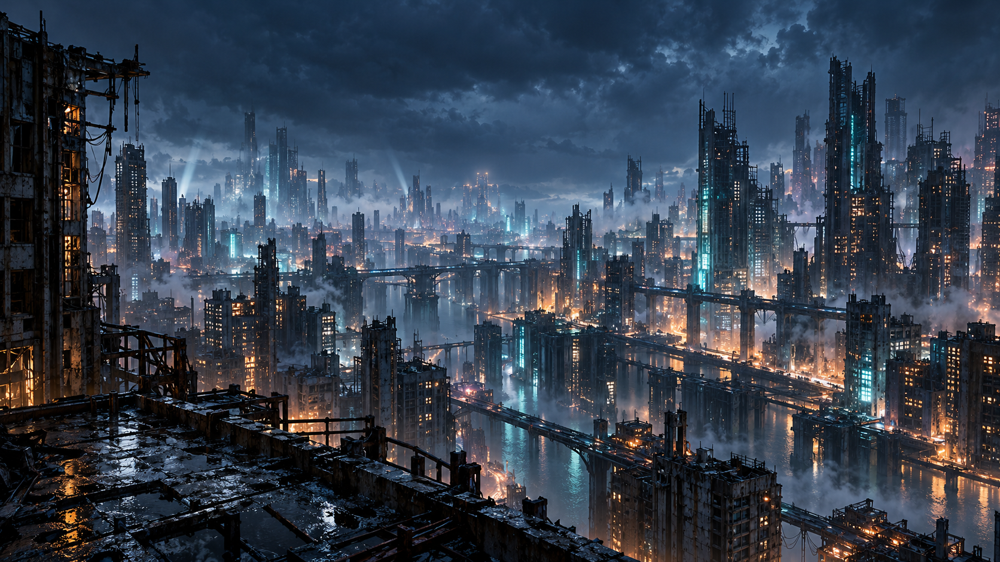

# Nightfall

Живые обои для **GNOME Shell 50**: семь атмосферных сцен, библиотека в отдельном окне и переключение из верхней панели. Текущий выпуск — **v15**.

[Предпросмотр в браузере](https://tanosxx.github.io/nightfall-wallpaper/) · [Скачать релиз](https://github.com/tanosxx/nightfall-wallpaper/releases) · [Сообщить о проблеме](https://github.com/tanosxx/nightfall-wallpaper/issues)



Обои работают локально: браузер, интернет и учётная запись для рабочего стола не нужны. Иллюстрации созданы с помощью генеративного ИИ; движение, свет, погода и другие эффекты рассчитываются во время работы. Это сцены на основе изображений с анимацией, а не полноценные трёхмерные миры.

## Коллекция

| Сцена | Что происходит |
| --- | --- |
| **Ночной рубеж** | Дождь, транспорт, огни окон, дым и течение воды в ночном городе. |
| **Полярный сигнал** | Сияние, снег, вода, маяки и жизнь полярной базы. |
| **Дальний рубеж** | Свет, пар, механизмы и сварка на космической станции; три режима освещения. |
| **Бездна** | Подводная база, прожекторы, лифт, переходы и движение в помещениях. |
| **Ночной узел** | Дальний поезд, разноцветный трафик, сигналы, окна и пар. |
| **Город над облаками** | Облака между башнями, турбины, маяки и далёкая гроза. |
| **Пепел титанов** | Пожары, дым, горящие корабли, работа у разрушенных роботов и индикаторы экзокостюма. |

В v15 все семь сцен входят в установочный пакет. **Онлайн-каталог в приложении, скачивание отдельных сцен и самостоятельная публикация сцен сообществом пока не реализованы.** Планы описаны в [ROADMAP](docs/ROADMAP.md).

## Установка готового релиза

Поддерживается GNOME Shell **50**. Установщик проверяет версию; поддержка других версий GNOME и других рабочих окружений не заявлена.

```bash
gnome-shell --version
```

Нужны `gnome-extensions`, системный Python 3 с `python3-gi`, GTK 4 и libadwaita. Установщик не устанавливает системные зависимости автоматически. Для готового релиза не нужны Node.js, Pillow, NumPy, отдельный `gjs` CLI или `glib-compile-schemas`.

1. Скачайте **`nightfall-v15-linux.tar.gz`** и `SHA256SUMS` со страницы [релиза](https://github.com/tanosxx/nightfall-wallpaper/releases).
2. В каталоге загрузки выполните:

```bash
sha256sum --check --ignore-missing SHA256SUMS
tar -xzf nightfall-v15-linux.tar.gz
cd nightfall-v15
bash install.sh --bundle ./nightfall@local.shell-extension.zip
```

Запускайте установщик **от своего пользователя, без `sudo`**. Он устанавливает расширение и значок приложения, сохраняя обычные настройки обоев.

Откройте **«Nightfall — Живые обои»** в меню приложений либо выполните:

```bash
gnome-extensions prefs nightfall@local
```

После установки или обновления GNOME может продолжать использовать прежний JavaScript из памяти. Если установщик сообщает об этом, сохраните работу, **выйдите из сеанса и войдите снова**. Переключение уже загруженных сцен нового входа не требует; установщик сам сеанс не завершает.

## Управление

- В библиотеке выберите сцену; меню Nightfall в верхней панели позволяет быстро переключаться между ними.
- **«Живые обои»** включает анимацию или возвращает обычный фон, сохраняя меню Nightfall.
- **«Пауза»** останавливает сцену. Регулятор меняет интенсивность осадков, течения, ветра или активности выбранного мира.
- Космическая станция имеет режимы рабочей смены, ночи и техобслуживания.

Настройки сохраняются между входами. Анимация приостанавливается при блокировке экрана и в обзоре GNOME. Движение курсора не управляет сценой.

Отключить или снова включить расширение:

```bash
gnome-extensions disable nightfall@local
gnome-extensions enable nightfall@local
```

Удалить его можно из распакованного релиза или исходников:

```bash
bash uninstall.sh
```

## Локальный предпросмотр

Из полной копии репозитория:

```bash
bash preview.sh
```

Откройте [http://127.0.0.1:8847/](http://127.0.0.1:8847/). Сервер слушает только локальный интерфейс; остановка — `Ctrl+C` в терминале. Предпросмотр использует локальные файлы, без внешних CDN.

`Space` — пауза, `F` — полный экран, `H` — скрыть управление. Его настройки сохраняются отдельно от настроек рабочего стола. Браузерный и нативный рендереры могут немного различаться; оценивать изменения нужно в обоих.

## Сборка и разработка

```bash
git clone https://github.com/tanosxx/nightfall-wallpaper.git
cd nightfall-wallpaper
bash install.sh
```

Установка из исходников дополнительно требует `gjs` и `glib-compile-schemas`. Готовые изображения, маски и атласы включены в репозиторий: для сборки не нужно заново генерировать иллюстрации или запускать графические генераторы.

Основные части проекта:

- `extension/nightfall@local/` — GJS/Cairo, меню, настройки и нативные рендереры.
- `extension/nightfall@local/scene-catalog.js` — общий каталог приложения и предпросмотра.
- `assets/` — композиции сцен и ресурсы эффектов; [описание ассетов](ASSETS.md).
- `index.html`, `library.js`, страницы сцен — браузерная библиотека и предпросмотр.
- `app/` — значок и launcher; `package-extension.py` — сборка установочного ZIP.
- `tests/`, `scripts/` — проверки и инструменты подготовки ресурсов.

Основные автоматические проверки:

```bash
bash scripts/check-source.sh
```

Проверка готового пакета без установки в текущий сеанс:

```bash
nightfall_build_dir="$(mktemp -d)"
python3 package-extension.py \
  --stage "$nightfall_build_dir/nightfall@local" \
  --archive "$nightfall_build_dir/nightfall@local.shell-extension.zip"
gjs -m tests/desktop-bundle.test.js "$nightfall_build_dir/nightfall@local"
```

Node.js нужен для тестов JavaScript, GJS/Cairo — для нативных проверок. Отдельные генераторы и проверки изображений требуют Pillow и NumPy; они не являются шагами установки. Подробнее — [CONTRIBUTING](CONTRIBUTING.md).

## Лицензия и происхождение изображений

Собственный код и материалы проекта распространяются на условиях **GPL-3.0-only** в пределах имеющихся у авторов прав. Для изображений, созданных ИИ, проект не заявляет исключительное авторское право. Условия и происхождение ресурсов: [LICENSE](LICENSE), [NOTICE.md](NOTICE.md), [ASSETS.md](ASSETS.md).

В сохранённом экспериментальном 3D-прототипе используется Three.js под [MIT](vendor/three/LICENSE). Этот компонент не используется текущим нативным рендерером и не входит в установочный пакет расширения.

О проблемах безопасности — [SECURITY.md](SECURITY.md).

## English — quick install

Nightfall v15 provides seven offline animated wallpapers for **GNOME Shell 50**. Download `nightfall-v15-linux.tar.gz` from [Releases](https://github.com/tanosxx/nightfall-wallpaper/releases), extract it, then run as your regular user:

```bash
cd nightfall-v15
bash install.sh --bundle ./nightfall@local.shell-extension.zip
gnome-extensions prefs nightfall@local
```

The installer requires `gnome-extensions`, system Python 3 with PyGObject, GTK 4 and libadwaita. Do not use `sudo`. Log out and back in if GNOME still holds an older extension version in memory. Run `bash uninstall.sh` from the extracted folder to uninstall.

Artwork was generated with AI tools. Project materials use GPL-3.0-only where applicable rights exist; preserved third-party notices are listed in [NOTICE.md](NOTICE.md). Individual scene downloads and a community publishing service are **planned, not available in v15**.
